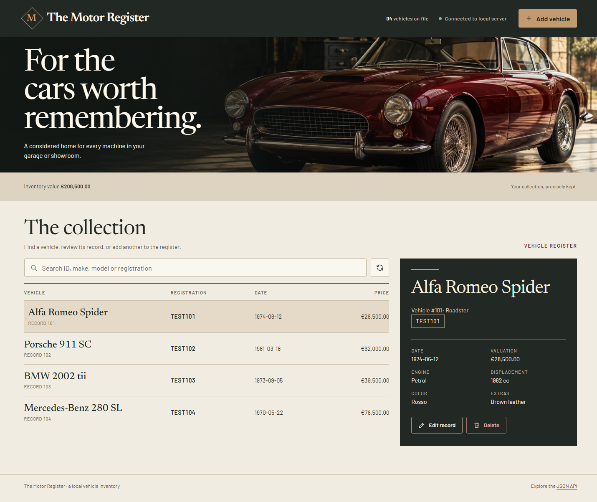
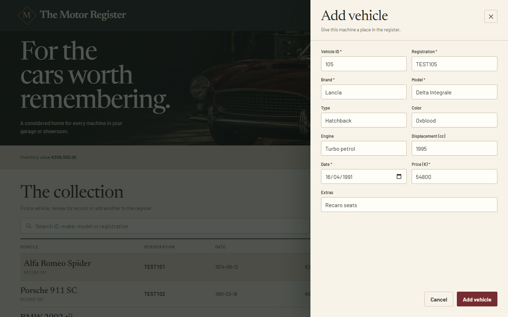
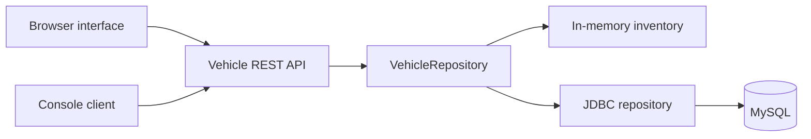

# 🚗 Java REST · Vehicle API

**Vehicle inventory REST API with a browser interface, command-line client, MySQL storage and a database-free demo mode.**


---

## 📌 About the Project

An academic client and server exercise rebuilt as two Maven modules. The server exposes vehicle CRUD operations over HTTP, serves **The Motor Register** browser interface and stores records in MySQL. The same API can run with temporary in-memory storage, so the interface, client and endpoints can be explored without configuring a database.

The original projects used NetBeans/Ant, an application server and Spanish Java and JSON names. This version runs on a standard JDK, uses English names throughout the current code, and provides its own database schema. It is a local learning project; the HTTP listener binds to `localhost`.

---

## 🖼️ Preview

<table>
  <tr>
    <th align="left">🚘 Vehicle collection</th>
    <th align="left">📝 Add vehicle form</th>
  </tr>
  <tr>
    <td>
      <a href="docs/images/motor-register-collection.png">
        
      </a>
    </td>
    <td>
      <a href="docs/images/motor-register-form.png">
        
      </a>
    </td>
  </tr>
</table>

*Both screenshots use illustrative records in demo mode. Click an image to view it at full size.*

---

## ✨ Features

- Create, list, find, update and delete vehicles through JSON endpoints.
- Manage the inventory in the browser, through the interactive console client, or with an HTTP client such as `Invoke-RestMethod`.
- Search the browser inventory, inspect a vehicle dossier, and add, edit or delete records in a responsive interface.
- See add and edit confirmations in the form before it closes automatically; deletion feedback clears after a short delay.
- Run the server with MySQL or an empty in-memory inventory.
- Validate required fields, a non-negative price and an ISO date.
- Return clear HTTP statuses for missing records, duplicates and invalid requests.

---

## 🛠️ Tech Stack

| Technology | Role |
| --- | --- |
| **Java 17+** | Server, console client and built-in HTTP listener |
| **Gson** | JSON serialization and parsing |
| **JDBC / MySQL Connector/J** | Persistent storage with prepared statements |
| **JUnit 5** | HTTP integration tests in demo mode |
| **Maven** | Multi-module compilation, dependencies and launch |

---

## 🧠 How It Works



The browser interface and console client send JSON to `http://localhost:8080/api/vehicles`. The server checks each request and calls the selected repository. Demo records disappear when the server stops. MySQL mode persists records in the `vehicle_api.vehicles` table.

---

## 📂 Project Structure

```text
java-rest-vehicle-api/
├── client/
│   ├── pom.xml
│   └── src/main/java/com/xandersdev/vehicleapi/client/
│       ├── ClientApp.java
│       ├── Vehicle.java
│       └── VehicleApiClient.java
├── database/
│   └── schema.sql
├── docs/
│   └── images/
│       ├── motor-register-collection.png
│       └── motor-register-form.png
├── server/
│   ├── pom.xml
│   ├── src/main/resources/web/
│   │   ├── index.html
│   │   └── assets/          # Stylesheet, garage image and locally hosted fonts
│   ├── src/main/java/com/xandersdev/vehicleapi/server/
│   │   ├── ServerApp.java
│   │   ├── Vehicle.java
│   │   ├── VehicleHttpServer.java
│   │   ├── VehicleRepository.java
│   │   ├── InMemoryVehicleRepository.java
│   │   └── JdbcVehicleRepository.java
│   └── src/test/java/com/xandersdev/vehicleapi/server/
│       └── VehicleHttpServerTest.java
├── .gitignore
├── .impeccable/       # Design brief, tokens and review captures
├── DESIGN.md
├── pom.xml
└── README.md
```

---

## 🚀 Getting Started

### Requirements

- **JDK 17 or newer** and **Maven 3.9+** on `PATH`.
- **MySQL 8+** only for persistent mode.

**Tested environment:** Windows 11, Java **21.0.11 LTS** and Maven **3.9.16**. The project targets Java 17.

The following commands use **Windows PowerShell** from the project root.

### Compile and test

```powershell
mvn test
```

Maven downloads dependencies on the first run. Tests use the in-memory repository and do not require MySQL.

### Run the demo without MySQL

Start the server in one terminal:

```powershell
mvn -pl server compile exec:java "-Dexec.args=--demo"
```

Open **http://localhost:8080/** in a browser to use The Motor Register. Its **Add vehicle** button opens the entry form; selecting a row reveals its details and edit/delete actions. Search filters the visible records, and the summary shows the count and total value.

The demo inventory starts empty. To add the four illustrative records shown in the collection screenshot at once, keep the server running and paste this entire block into a **separate PowerShell terminal**, at the normal `PS ...>` prompt. The block sends four API requests. Do not paste it at the interactive client's `Choose an option:` prompt. You can also add the records individually through the browser form.

```powershell
$sampleVehicles = @'
[
  {"id":101,"brand":"Alfa Romeo","model":"Spider","type":"Roadster","color":"Rosso","engine":"Petrol","displacement":1962,"date":"1974-06-12","registration":"TEST101","extras":"Brown leather","price":28500},
  {"id":102,"brand":"Porsche","model":"911 SC","type":"Coupé","color":"Silver","engine":"Flat-six","displacement":2994,"date":"1981-03-18","registration":"TEST102","extras":"Fuchs wheels","price":62000},
  {"id":103,"brand":"BMW","model":"2002 tii","type":"Saloon","color":"Chamonix","engine":"Petrol","displacement":1990,"date":"1973-09-05","registration":"TEST103","extras":"Sport seats","price":39500},
  {"id":104,"brand":"Mercedes-Benz","model":"280 SL","type":"Roadster","color":"Dark green","engine":"Petrol","displacement":2778,"date":"1970-05-22","registration":"TEST104","extras":"Hardtop","price":78500}
]
'@ | ConvertFrom-Json

foreach ($vehicle in $sampleVehicles) {
    Invoke-RestMethod -Uri 'http://localhost:8080/api/vehicles' -Method Post -ContentType 'application/json' -Body ($vehicle | ConvertTo-Json -Compress) | Out-Null
}
```

The form screenshot shows a fifth example, a Lancia Delta Integrale, being entered but not yet saved. Demo records disappear when the server stops.

To use the interactive console client instead, run this in another terminal. Its **Add vehicle** option prompts for one vehicle at a time:

```powershell
mvn -pl client compile exec:java
```

### Run with MySQL

Load the schema with a running MySQL server and its command-line client on `PATH`:

```powershell
mysql -u root -p --execute="source database/schema.sql"
```

Set credentials for the current PowerShell session, then run the server:

```powershell
$env:DB_URL = "jdbc:mysql://localhost:3306/vehicle_api"
$env:DB_USER = "root"
$env:DB_PASSWORD = "your_password"
mvn -pl server compile exec:java
```

`DB_URL` defaults to the URL above, `DB_USER` to `root`, and `DB_PASSWORD` to an empty string. `API_PORT` changes the server port; set `API_URL` to the corresponding full collection URL when running the client on a different port.

### Endpoints

| Method | Path | Result |
| --- | --- | --- |
| `GET` | `/` or `/index.html` | Browser interface |
| `GET` | `/assets/*` | Browser stylesheet, image and font assets |
| `GET` | `/api/vehicles` | All vehicles |
| `GET` | `/api/vehicles/{id}` | One vehicle, or `404` |
| `POST` | `/api/vehicles` | Create a vehicle (`201`), or `409` for a duplicate |
| `PUT` | `/api/vehicles/{id}` | Replace a vehicle; body ID must match the URL |
| `DELETE` | `/api/vehicles/{id}` | Delete a vehicle (`204`), or `404` |

For a `POST` or `PUT` request body, use any one of the four vehicle JSON objects in the demo example above. Send a single object, not the surrounding array; the PowerShell loop posts each object separately.

---

## 📊 Results

`mvn test` compiles both modules, verifies CRUD and error responses against the running demo HTTP server, confirms that the browser page is served, and checks the client item route and error handling. The browser flow was also checked in demo mode: add and edit confirmations appear in the form and close automatically, while the delete confirmation disappears after its delay. MySQL storage requires a local database and is not covered by these tests.
